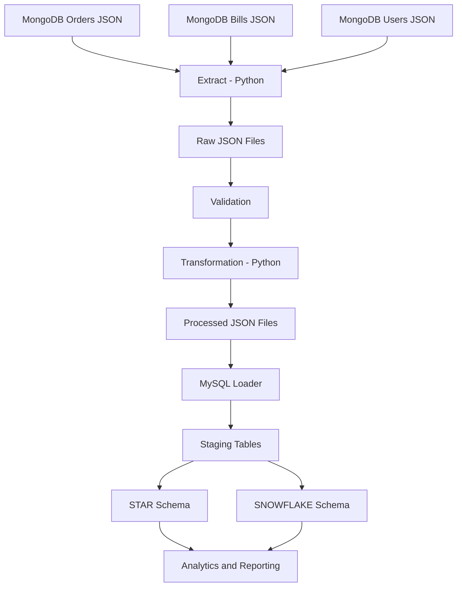
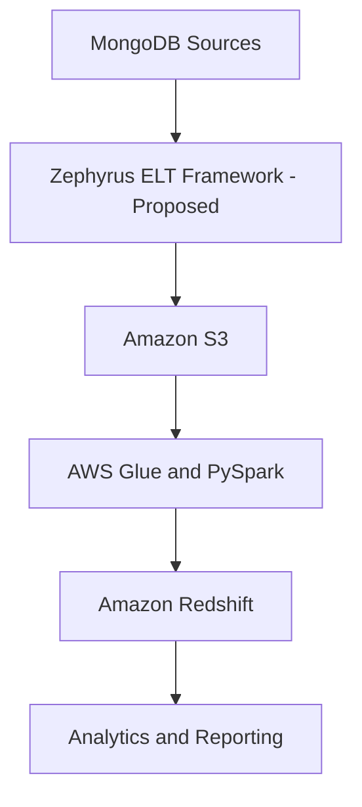

# Data Pipeline Architecture

## Source to MySQL Data Warehouse

## Proposed Cloud Architecture

**Note:** The local implementation uses Python and MySQL. The AWS diagram represents a proposed cloud architecture, not a deployed environment.
